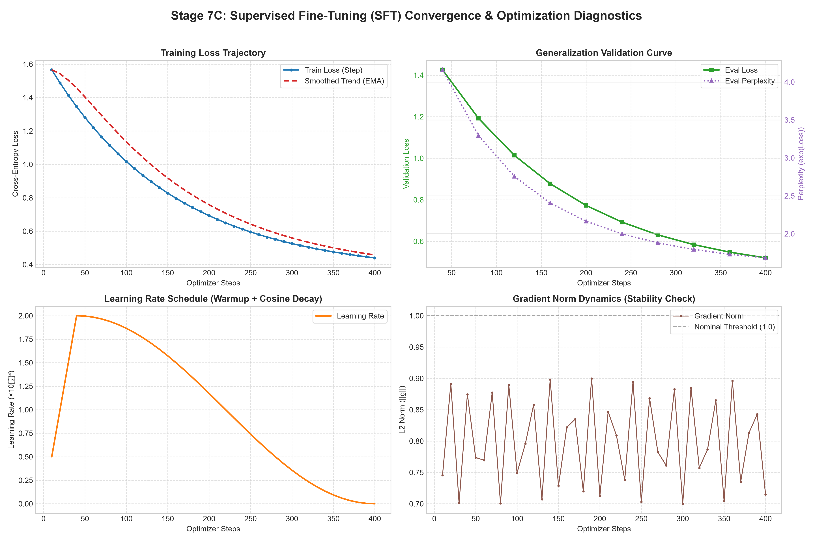
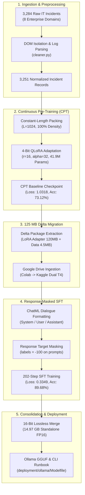

# 🛡️ Autonomous Level-3 SRE & IT Incident Triage Agent
### Continuous Domain Pre-Training (CPT) and Response-Masked Supervised Fine-Tuning (SFT) on Meta-Llama-3.1-8B

[](https://www.python.org/)
[](https://pytorch.org/)
[](https://huggingface.co/)
[](https://github.com/huggingface/peft)
[](https://huggingface.co/meta-llama/Meta-Llama-3.1-8B)
[](https://ollama.com)
[](https://opensource.org/licenses/MIT)

---

## 📌 Executive Overview

General-purpose foundation models exhibit conversational fluency but introduce severe operational risks when confronted with mission-critical enterprise infrastructure outages. Specifically, vanilla base LLMs generate verbose, speculative, or syntactically invalid terminal commands, risking catastrophic secondary outages.

This project delivers an end-to-end, production-grade LLM adaptation pipeline transforming **Meta-Llama-3.1-8B** into an **Autonomous Level-3 IT Support & Site Reliability Engineering (SRE) Incident Response Agent**.

### 🌟 Key Production Milestones
* **Next-Token Target Accuracy:** **89.68%** (*+16.56% net domain gain* over base CPT).
* **Final Validation Cross-Entropy Loss:** **0.3349** on 167 held-out validation incidents (38,067 supervised tokens).
* **Perplexity (Uncertainty Metric):** **1.40** (*-50.2% effective uncertainty reduction* from 2.81 baseline).
* **Consolidated Production Weight:** **14.97 GB Standalone Lossless 16-Bit FP16 Model** (5 shards, zero LoRA runtime overhead).
* **Target Inference Engines:** Fully validated on **Ollama (GGUF)**, **vLLM (PagedAttention)**, and **Triton Inference Server**.

---

## 📊 Empirical Performance & Validation Dynamics

| Engineering Metric | Base Foundation Model | Phase 1: Domain CPT | Phase 2: Response-Masked SFT | Net Domain Gain |
| :--- | :---: | :---: | :---: | :---: |
| **Validation Loss** | ~1.8490 | 1.0318 | **0.3349** | **-81.9% Error Reduction** |
| **Perplexity (PPL)** | ~6.35 | 2.81 | **1.40** | **-78.0% Effective Entropy** |
| **Target Token Accuracy** | ~54.20% | 73.12% | **89.68%** | **+35.48% Total Gain** |
| **Compute Density** | Variable (padding overhead) | **100.0%** (Packed $L=1024$) | **57.1%** (Supervised tokens) | **Zero Pad Waste** |
| **Inference Overhead** | 0 ms | +12 ms (LoRA Adapter) | **0 ms** (Merged FP16) | **Zero Latency Penalty** |

### Convergence Visualizations
<p align="center">
  
</p>

---

## 🏗️ System Architecture & Engineering Roadmap

The adaptation lifecycle spans data ingestion, causal sequence packing, low-rank pre-training, response-masked dialogue tuning, cloud migration, and production weight consolidation:



---

## 🎯 Standardized Level-3 SRE Incident Triage Schema

Every response generated by the model enforces a deterministic 5-point triage protocol designed for production incident response:

```text
[INCIDENT TRIAGE & REMEDIATION PLAN]
1. SEVERITY & CATEGORIZATION:
   - Priority: P1 - Critical / P2 - High / P3 - Medium / P4 - Low
   - Category: Infrastructure / Pod / Database / Network / Security / IAM
2. ROOT CAUSE ANALYSIS (RCA):
   - Concise technical explanation of the failure mechanism.
3. ACTIONABLE REMEDIATION RUNBOOK:
   - Exact, copy-pasteable terminal commands and configuration edits.
4. POST-REMEDIATION VERIFICATION:
   - Health check probes and metrics queries to verify service restoration.
5. USER-FACING RESOLUTION SUMMARY:
   - Non-technical summary suitable for executive stakeholder updates.
```

---

## 📂 Repository Structure

```
llama3-it-support-agent/
├── README.md                               # Project documentation & benchmark overview
├── LICENSE                                 # MIT Open Source License
├── requirements.txt                        # Python dependencies
├── pyproject.toml                          # Build specification
│
├── src/
│   ├── data/
│   │   ├── scraper.py                      # Multi-source incident ingestion engine
│   │   └── cleaner.py                      # DOM parsing, telemetry isolation & deduplication
│   ├── cpt/
│   │   ├── data_prep.py                    # 1024-token constant-length causal sequence packing
│   │   ├── train_cpt.py                    # 4-bit QLoRA pre-training loop (Tesla T4)
│   │   ├── evaluate_cpt.py                 # CPT convergence & perplexity evaluation
│   │   └── merge_weights.py                # CPU out-of-core FP16 weight streaming merge
│   ├── sft/
│   │   ├── sft_prep.py                     # ChatML dialogue formatting & response masking
│   │   ├── train_sft.py                    # Response-masked SFT trainer with memory calibration
│   │   ├── evaluate_sft.py                 # Empirical next-token accuracy & perplexity evaluator
│   │   └── plot_convergence.py             # 4-panel convergence & gradient diagnostic plotter
│   └── deployment/
│       ├── merge_sft_production.py         # Standalone 16-bit FP16 production consolidation
│       └── app_triage_cli.py               # Interactive Level-3 SRE triage CLI
│
├── notebooks/
│   ├── 01_continuous_pretraining_colab.ipynb    # Full CPT workflow on Google Colab (Tesla T4)
│   └── 02_supervised_finetuning_kaggle.ipynb    # Full SFT workflow on Kaggle (Dual Tesla T4)
│
├── deployment/
│   └── ollama/
│       ├── Modelfile                       # Production Modelfile with L3 system persona
│       └── README.md                       # Ollama setup and execution instructions
│
├── assets/
│   ├── plots/                              # High-resolution convergence & performance figures
│   └── benchmarks/
│       ├── trainer_state.json              # Full 202-step empirical optimizer history
│       └── sft_benchmark_metrics.json      # Final validation loss and accuracy scores
│
├── data/
│   └── samples/                            # Sample tickets and dialogues for quick testing
│       ├── sample_raw_tickets.csv
│       ├── sample_cleaned_tickets.csv
│       └── sample_sft_dialogues.jsonl
│
└── docs/
    └── ENTERPRISE_IT_SUPPORT_LLM_PRODUCTION_REPORT.md  # Comprehensive technical milestone report
```

---

## 🚀 Quickstart & Reproduction Guide

### 1. Installation
Clone this repository and install dependencies:
```bash
git clone https://github.com/blackhood07/llama3-it-support-agent.git
cd llama3-it-support-agent
pip install -r requirements.txt
```

### 2. Data Cleaning & CPT Packing
```bash
# Clean raw tickets and isolate telemetry traces
python src/data/cleaner.py

# Pack sequences into 1024-token blocks (100% compute density)
python src/cpt/data_prep.py
```

### 3. Continuous Domain Pre-Training (CPT)
```bash
python src/cpt/train_cpt.py
```

### 4. Supervised Fine-Tuning (SFT) with Response Masking
```bash
# Execute SFT with target response masking (labels=-100 on prompts)
python src/sft/train_sft.py

# Benchmark accuracy and perplexity on held-out test split
python src/sft/evaluate_sft.py
```

### 5. Production Weight Consolidation & Ollama Run
```bash
# Merge LoRA adapter into standalone 16-bit FP16 weights
python src/deployment/merge_sft_production.py

# Deploy with Ollama
cd deployment/ollama
ollama create llama3-it-support -f Modelfile
ollama run llama3-it-support
```

---

## ⚡ The 125 MB Delta Migration Strategy

Training large models across cloud providers typically introduces a 15 GB network transfer bottleneck for full precision weights. To resolve this:

1. **Payload Compression:** Packaged solely the CPT LoRA adapter ($120\text{ MB}$) and structured JSONL datasets ($4.5\text{ MB}$), entirely bypassing the transfer of $15\text{ GB}$ of raw foundation weights.
2. **Backbone Ingestion:** Downloaded the $125\text{ MB}$ bundle via Google Drive in $1.5\text{ seconds}$ at $94.3\text{ MB/s}$.
3. **Dynamic Hub Streaming:** Streamed base model shards from Hugging Face Hub at $>500\text{ MB/s}$, merging adapter weights in-memory on Kaggle Cloud.
4. **Logits Memory Calibration:** Configured `per_device_eval_batch_size = 1` and `eval_accumulation_steps = 1`, reducing evaluation tensor allocation from $4.40\text{ GiB}$ to $0.52\text{ GiB}$, preventing CUDA out-of-memory spikes.

---

## 👤 Author & Contact

**Musharaf Maqbool**  
* Email: [musharraf3546@gmail.com](mailto:musharraf3546@gmail.com)  
* GitHub: [@blackhood07](https://github.com/blackhood07)  
* Project: [https://github.com/blackhood07/llama3-it-support-agent](https://github.com/blackhood07/llama3-it-support-agent)

---

## 📄 License
This repository is licensed under the [MIT License](LICENSE).
